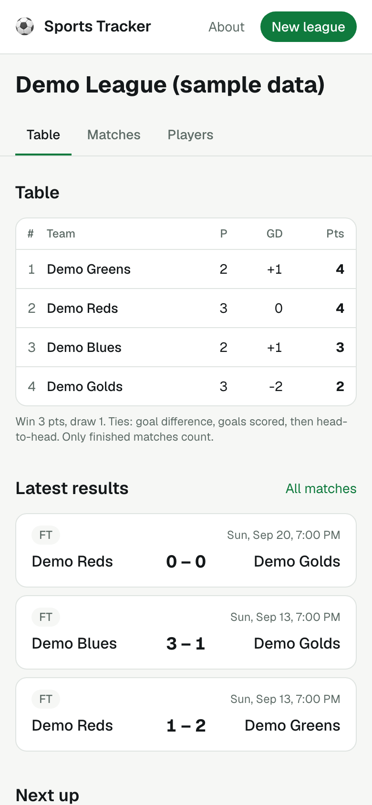
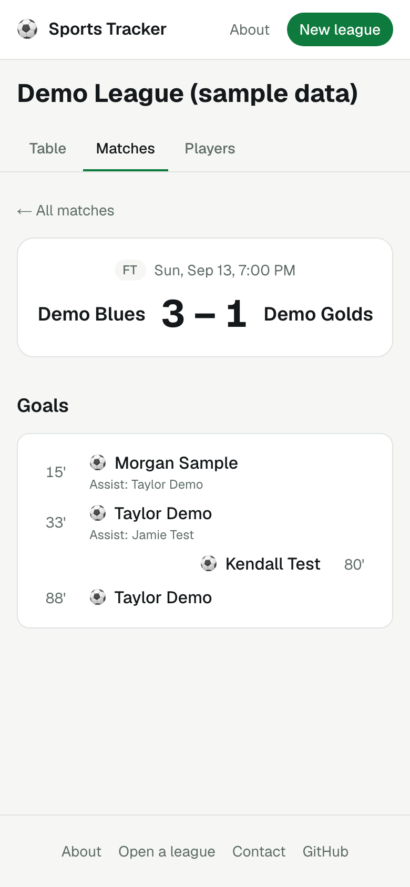
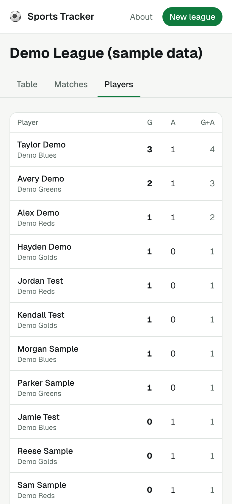
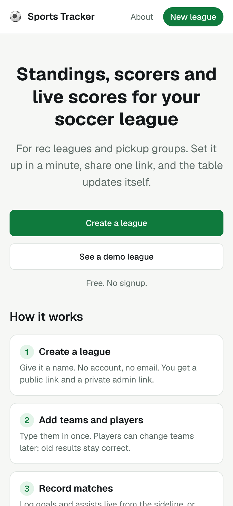
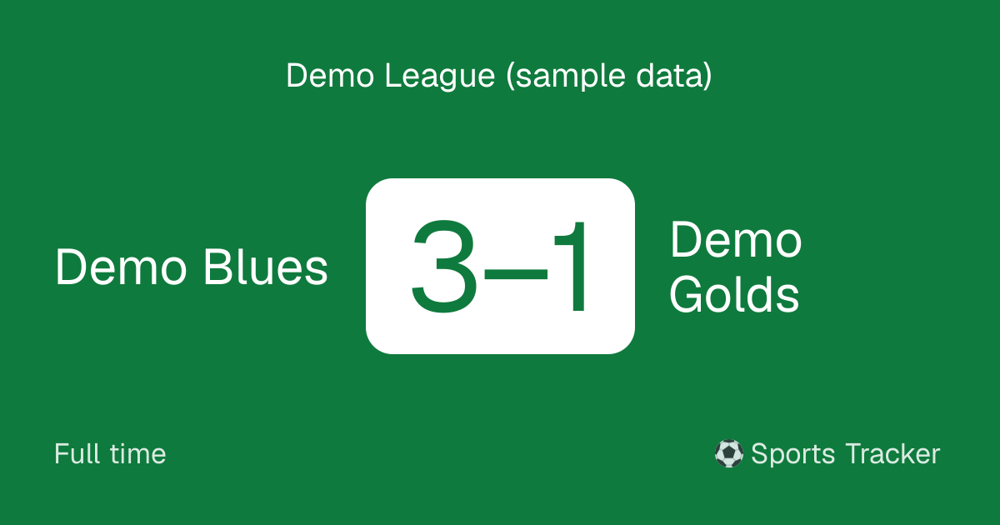

# Sports Tracker

A soccer league tracker for rec and pickup groups. Create a league without signing up,
record matches (score, scorers, assists), and everyone gets standings, player stats and
live scores on their phone.

**Live app:** not deployed yet. The account steps are in [docs/DEPLOY.md](docs/DEPLOY.md).

| League table | Match | Player stats | Home |
|---|---|---|---|
|  |  |  |  |

Pasting a match link into a chat shows a score card:



All names and results in the screenshots are demo data from [prisma/seed.ts](prisma/seed.ts).

## What it does

- **No accounts.** Creating a league gives you a public link (read-only, share it) and a
  secret admin link (edit). Only a hash of the admin token is stored.
- **Teams, players, matches, goals and assists**, entered from a phone.
- **Standings** with 3/1/0 points and tiebreakers: goal difference, goals scored,
  head-to-head, then a shared position.
- **Player stats**: goals, assists, goals + assists.
- **Live mode**: the admin logs goals during the game; public pages update within about
  3 seconds without a refresh, with a running match clock.
- **Share image** for match links (Open Graph).

## Tech

Next.js 16 (App Router, Server Components, Server Actions) · React 19 · Tailwind CSS 4 ·
Prisma 7 + PostgreSQL 17 · Zod · Vitest · Playwright · GitHub Actions · Vercel + Neon.

## Local setup

Requirements: Node 24 (see `.nvmrc`) and Docker.

```bash
npm install                 # also generates the Prisma client
cp .env.example .env        # local defaults work as-is
docker compose up -d        # Postgres 17 on localhost:5433
npm run db:migrate          # apply migrations
npm run db:seed             # demo league; prints its public and admin links
npm run dev                 # http://localhost:3000
```

## Scripts

| Script | What it does |
|---|---|
| `npm run dev` | Next.js dev server |
| `npm run build` | Production build |
| `npm run lint` | ESLint |
| `npm run typecheck` | Generate route types, then `tsc --noEmit` |
| `npm test` | Vitest unit tests (`npm run test:watch` to watch) |
| `npm run test:e2e` | Playwright end-to-end tests (`npm run test:e2e:ui` for UI mode) |
| `npm run db:migrate` | Create/apply Prisma migrations in development |
| `npm run db:seed` | Replace the demo league |
| `npm run db:reset` | Drop the local database, re-apply migrations, re-seed |
| `npm run screenshots` | Re-take the README screenshots (see `scripts/screenshots.ts`) |

## Docs

Learning the codebase? Start with the first three.

- [docs/ARCHITECTURE.md](docs/ARCHITECTURE.md): diagrams of the data flow and layers, and why
- [docs/WALKTHROUGH.md](docs/WALKTHROUGH.md): files in reading order, then one goal traced end to end
- [docs/QUIZ.md](docs/QUIZ.md): 15 questions to check your understanding (answers at the bottom)
- [e2e/README.md](e2e/README.md): the Playwright suite and how to extend it
- [docs/PLAN.md](docs/PLAN.md): architecture and milestones
- [docs/DECISIONS.md](docs/DECISIONS.md): every choice and why
- [docs/PROGRESS.md](docs/PROGRESS.md): done / in progress / next
- [docs/DEPLOY.md](docs/DEPLOY.md): deploying to Vercel + Neon

## How it was built

Built by an AI coding agent (Claude Code) working from the brief in
[CLAUDE.md](CLAUDE.md), in small commits with one pull request per milestone. Each
choice and its reason is logged in [docs/DECISIONS.md](docs/DECISIONS.md), and CI checks
lint, types, unit tests, migrations, the build and the Playwright suite on every pull
request.
