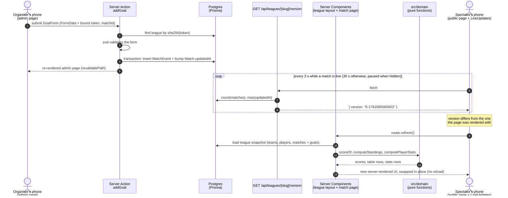
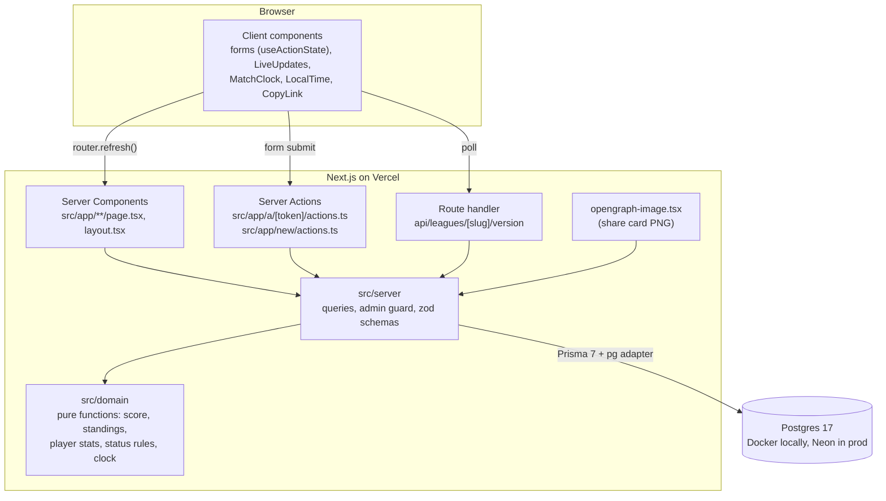

# Architecture

Sports Tracker is one Next.js app talking to one Postgres database. There is no separate
API server, no client-side state library and no websocket service. Each piece below
exists for a reason, given in the last section.

## The main data flow

What happens when the organiser records a goal and a spectator is watching the match page:

## The layers

| Folder | Rule |
|---|---|
| `src/domain/` | No I/O, no framework imports. Plain data in, plain data out. Every function has unit tests next to it. |
| `src/server/` | Everything that touches the database. Marked `server-only` so it can't end up in a browser bundle. |
| `src/app/` | Routes. Pages read through `src/server`; Server Actions write through Prisma after the admin guard. |
| `src/components/` | UI. Server components by default; `"use client"` only where the browser is needed (state, effects, clipboard, timezone). |
| `src/lib/` | Small helpers used on both sides: the Prisma client, tokens, form state type, link parsing. |
| `prisma/` | Schema, migrations, demo seed. |
| `e2e/` | Playwright suite (page objects + fixtures). |

## Why it's built this way

**One app, server-first.** Server Components read the database directly and render HTML;
Server Actions are typed functions that forms post to. There is no REST layer to keep in
sync and almost no client JavaScript beyond forms and the poller. For a small app with
one developer, that's the least code that does the job.

**Calculations are pure functions.** The standings rules (points, goal difference,
head-to-head, shared positions) are the part most likely to be wrong and most annoying to
debug through a UI. Keeping them in `src/domain` as functions over arrays makes each rule
a three-line unit test. The database layer only fetches rows and passes them in.

**The score is derived, never stored.** A match's score is the count of its goal events.
So there's one source of truth: the score, the table and the player stats can't disagree,
and deleting a wrong goal fixes all three at once.

**Load the whole league per request.** A rec league has tens of matches. Loading all of
them (three queries) and computing everything in memory is fast, simple and always
consistent. React's `cache()` makes the layout and the page share one load per request.
This would need rethinking at thousands of matches per league, not before.

**No accounts: a secret link.** The target users are a pickup group that won't sign up for
anything. The admin link carries a 192-bit random token; the database stores only its
SHA-256 hash, and every Server Action re-checks it and filters every write by the
league's id. Trade-off: a lost admin link can't be recovered.

**Live updates by polling a version number.** Vercel's serverless functions can't hold
websockets, and a hosted realtime service would add an account, secrets and a second
system to learn. Instead the page asks "did anything change?" every 3 seconds (one tiny
aggregate query) and, only when it did, re-renders itself with `router.refresh()`, using
the same server rendering as a normal page load. Cost: up to ~3 s delay. See
docs/DECISIONS.md, M3, for the alternatives considered.

**Prisma 7 with the `pg` driver adapter.** Same code path locally (Docker) and in
production (Neon). The app uses Neon's pooled connection; migrations use the direct one
and run during the Vercel build, so code and schema deploy together.

**Tests at two levels.** Vitest covers the rules (fast, many cases). Playwright covers the
flows a user cares about (create, record, standings, live), on a phone-sized and a
desktop browser, against a production build in CI.
